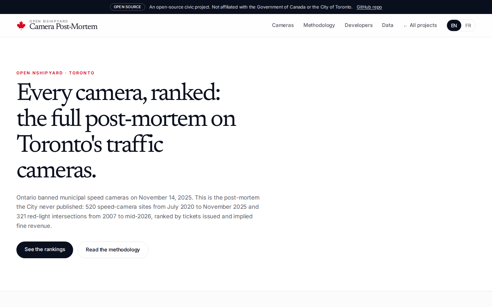
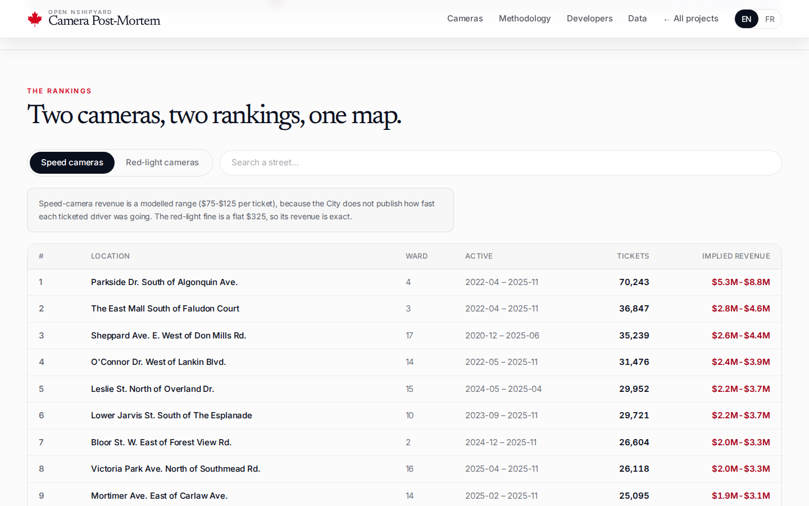
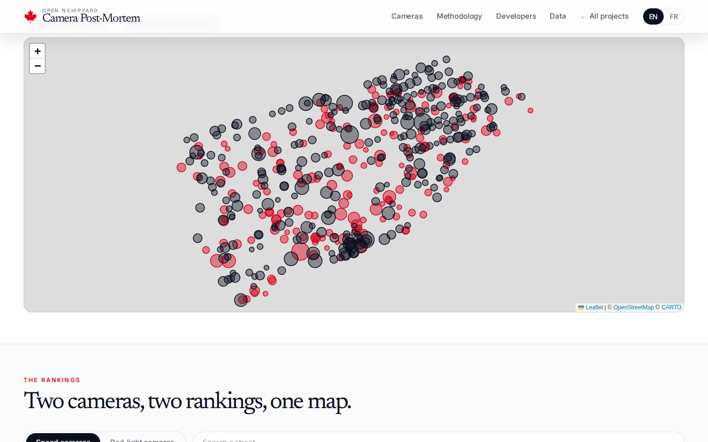
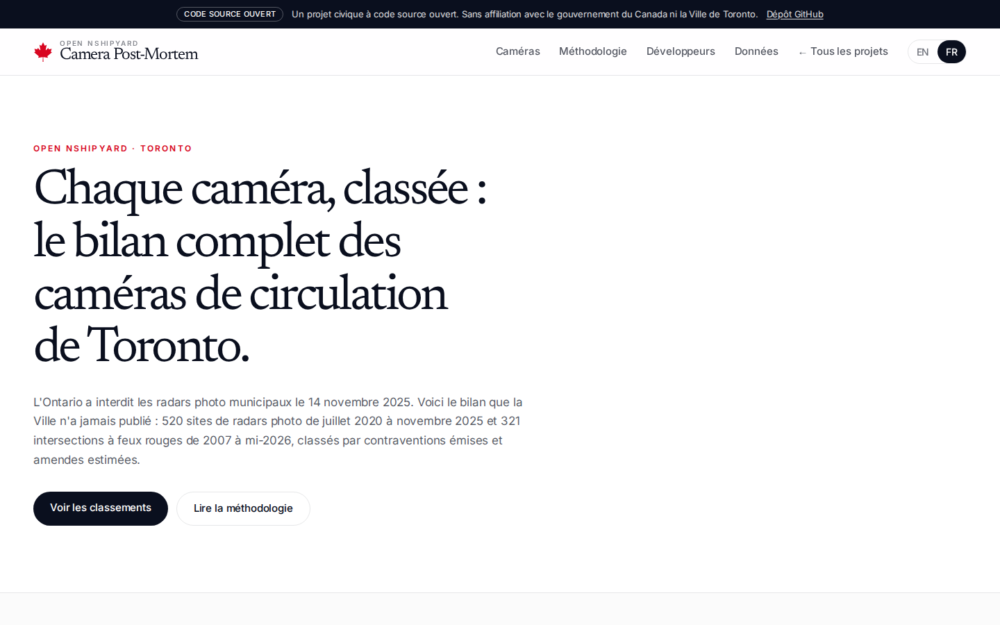
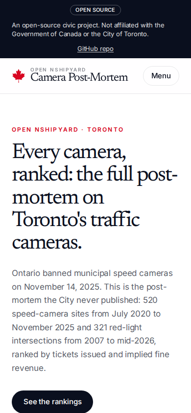

# The Camera Post-Mortem

Ontario banned municipal speed cameras on November 14, 2025. This is the post-mortem the City of Toronto never published: 520 speed-camera sites (July 2020 to November 2025) and 321 red-light intersections (2007 to mid-2026), ranked by tickets issued and implied fine revenue, on one map.

Live: https://cameras.canada.nshipyard.com

## Screenshots







## Headline figures

- 2,150,715 speed-camera tickets, July 2020 to November 2025
- $161.3M-$268.8M modelled speed-camera fine revenue (a range, never an exact figure)
- 1,304,807 red-light tickets, 2007 to June 2026
- $424.1M exact implied red-light fine revenue ($325 per ticket)
- Busiest speed-camera site: Parkside Dr. South of Algonquin Ave. (A207), 70,243 tickets, $5.27M-$8.78M modelled
- Busiest red-light intersection: Bayview Ave. and Truman Rd. (2517), 35,892 tickets, $11.66M implied

## Data sources

- [Automated Speed Enforcement (ASE) Charges](https://open.toronto.ca/dataset/automated-speed-enforcement-ase-charges/): monthly ticket counts per site code, July 2020 onward
- [Automated Speed Enforcement Locations](https://open.toronto.ca/dataset/automated-speed-enforcement-locations/): current camera site points
- [Red Light Camera Annual Charges](https://open.toronto.ca/dataset/red-light-camera-annual-charges/): annual ticket counts per intersection, 2007 onward
- [Red Light Cameras](https://open.toronto.ca/dataset/red-light-cameras/): intersection points

Data vintage: speed cameras July 2020 to November 2025, red-light cameras 2007 to June 2026 (2026 partial). Downloaded and built October 9, 2026.

## Methodology

`scripts/build_cameras.py` reproduces the full pipeline from the snapshots in `data/raw/`. Key steps:

- 631 raw charge rows share 520 unique site codes (cameras rotated back to sites under reused codes); rows sharing a code were summed into one site record.
- The ASE locations file carries no site code (the field holds the literal text "None" on every row), so sites join to map points by normalized location name. 185 of 520 sites matched; the rest are retired sites the locations file no longer lists, so they are ranked but not drawn.
- Red-light charges join to locations by code offset: location code = charge code + 3500 (301 of 321 matched).
- Red-light revenue is exact: $325 per ticket ($260 set fine + $60 victim surcharge + $5 court costs).
- Speed-camera revenue is a modelled range of $75-$125 per ticket. Fines vary with speed over the limit (Ontario Regulation 355/22; ASE cameras sit in community safety zones where the Highway Traffic Act doubles the per-kilometre rate), and the City does not publish speed distributions. The range is calibrated against published reporting: the Parkside Dr camera's 63,000 charges and $6.8M in fines (December 2024) average about $108 per ticket, inside the range.

See the Methodology section on the site for the full writeup, including what was left out.

## API

- `GET /api/v1/summary`: citywide aggregates, top 25 lists, anchors, methodology notes
- `GET /api/v1/ase/sites?q=&limit=`: search speed-camera sites by street name
- `GET /api/v1/ase/site?code=A207`: one site, full record plus monthly series
- `GET /api/v1/redlight/intersections?q=&limit=`: search red-light intersections
- `GET /api/v1/redlight/intersection?code=2578`: one intersection, full record plus annual series
- `GET /api/openapi.json`: OpenAPI 3.1 document
- `POST /mcp`: MCP server (JSON-RPC 2.0) for AI agents

The normalized datasets are also downloadable from the site: `ase_sites.csv`, `redlight.csv`, `summary.json`.

## Development

Next.js 16, TypeScript, Tailwind CSS 4, Leaflet. English and French.

```bash
python3 scripts/build_cameras.py   # rebuild public/data from data/raw
npm install
npm run build
npm run start
```

## Author

Built by [Richardson Dackam](https://x.com/richardsondx) ([GitHub](https://github.com/richardsondx)). Open source, MIT licensed. Not affiliated with the Government of Canada or the City of Toronto.
